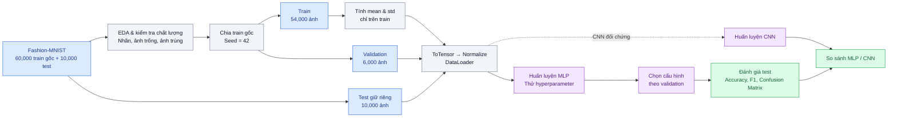

# Fashion-MNIST Classification | Lab 1

**Data Pipeline · Exploratory Data Analysis · MLP · CNN · Hyperparameter Tuning · Model Evaluation**

Dự án thực hành phân loại ảnh thời trang bằng **PyTorch** trên bộ dữ liệu **Fashion-MNIST**. Notebook triển khai toàn bộ quy trình từ khảo sát dữ liệu, làm sạch, chuẩn hóa, huấn luyện MLP, tối ưu siêu tham số đến đánh giá và đối chiếu với CNN. Các số liệu dưới đây được trích từ **kết quả thực thi đã lưu trong `lab1.ipynb`**, không phải kết quả giả định.

## 1. Tổng quan kết quả

| Chỉ số | MLP được chọn | CNN nhỏ |
|---|---:|---:|
| Validation accuracy | **89.32%** | **92.15%** |
| Test accuracy | **88.67%** | **91.59%** |
| Số tham số | 235,146 | 421,834 |
| Số epoch trong lần so sánh | 10 | 8 |
| Kiến trúc | Flatten → Dense 256 → Dense 128 → 10 lớp | 2 khối Conv–BN–ReLU–Pool → Dense → 10 lớp |

**Kết luận nhanh:** CNN cao hơn MLP **2.92 điểm phần trăm** trên test (91.59% so với 88.67%), đổi lại số tham số nhiều hơn khoảng **1.79 lần**. Đây là kết quả của lần chạy đã lưu, chưa phải kết luận thống kê trên nhiều seed.

## 2. Dataset và phân chia dữ liệu

- **Nguồn:** [Fashion-MNIST — Zalando Research](https://github.com/zalandoresearch/fashion-mnist), tải bằng `torchvision.datasets.FashionMNIST`.
- **Quy mô:** 70,000 ảnh grayscale, kích thước **28 × 28**; gồm 60,000 ảnh train gốc và 10,000 ảnh test gốc.
- **10 nhãn:** T-shirt/top, Trouser, Pullover, Dress, Coat, Sandal, Shirt, Sneaker, Bag, Ankle boot.
- **Phân chia sử dụng:** 54,000 train / 6,000 validation / 10,000 test. Validation được tách ngẫu nhiên từ train gốc với `SEED=42`; test được giữ riêng để đánh giá cuối.
- **Phân bố lớp ban đầu:** mỗi lớp có 6,000 ảnh train gốc và 1,000 ảnh test (cân bằng).


**Nhận xét:** Bộ dữ liệu gốc cân bằng nên accuracy là chỉ số tổng quan phù hợp, nhưng vẫn cần precision/recall/F1 theo lớp để phát hiện nhóm khó nhận diện. Việc chia train/validation ngẫu nhiên khiến số mẫu mỗi lớp ở hai tập con không hoàn toàn bằng nhau.

## 3. Khảo sát dữ liệu (EDA)

### 3.1. Ảnh mẫu và ảnh trung bình


Các ảnh thuộc cùng nhóm có hình dạng chung, nhưng những loại áo như **Shirt, Pullover, Coat** có đặc trưng thị giác tương đối giống nhau; điều này gợi ý nguy cơ nhầm lẫn khi phân loại.

### 3.2. Kiểm tra chất lượng và thống kê pixel

| Phép kiểm tra / thống kê | Kết quả từ notebook |
|---|---:|
| Ảnh trống trong train | 0 |
| Ảnh trùng lặp trong train (hash ảnh) | 0 |
| Ảnh train xuất hiện trong test (hash ảnh) | 0 |
| Mean pixel toàn tập train gốc (thang 0–1) | 0.2860 |
| Std pixel toàn tập train gốc (thang 0–1) | 0.3530 |
| Tỷ lệ pixel bằng 0 | 50.21% |


**Nhận xét:** Khoảng một nửa pixel có giá trị 0, phản ánh nền tối chiếm tỷ lệ lớn trong ảnh. Các phép kiểm tra hash không phát hiện trùng lặp ảnh giống hệt ở những phạm vi đã kiểm tra; điều này **không loại trừ mọi dạng trùng lặp gần giống**.

### 3.3. Mức độ tương đồng giữa các lớp


Năm cặp ảnh trung bình gần nhau nhất theo khoảng cách Euclid:

| Cặp lớp | Khoảng cách |
|---|---:|
| Pullover – Coat | 2.48 |
| Pullover – Shirt | 2.68 |
| Coat – Shirt | 3.02 |
| T-shirt/top – Shirt | 3.72 |
| Sandal – Sneaker | 3.84 |

**Nhận xét:** Khoảng cách giữa ảnh trung bình là tín hiệu thăm dò, không phải xác suất nhầm lẫn. Tuy vậy, các cặp Pullover/Coat/Shirt cũng xuất hiện trong những lỗi phân loại lớn nhất của MLP, cho thấy sự phù hợp giữa EDA và kết quả đánh giá.

### 3.4. Phân tích PCA


Notebook áp dụng PCA cho **6,000 ảnh lấy mẫu**, thử **50 thành phần chính** và thu được **86.3% phương sai giải thích**. Vì chưa đạt 90%, không thể kết luận số thành phần cần thiết để giữ 90% phương sai chỉ từ phép thử 50 thành phần này. PCA dùng để **phân tích/trực quan**, **không** làm đầu vào huấn luyện MLP/CNN.

## 4. Data Pipeline

Sơ đồ Mermaid được hiển thị trực tiếp trên GitHub theo **chiều ngang (trái → phải)**. Quy trình phân biệt rõ dữ liệu dùng để huấn luyện và tập test được giữ riêng để đánh giá cuối cùng.



> **Lưu ý về luồng dữ liệu:** Sơ đồ minh họa các bước của thí nghiệm, không có nghĩa tập test được dùng để huấn luyện hay chọn hyperparameter. Mean/std chỉ được tính trên train; validation dùng để chọn cấu hình và test chỉ dùng cho đánh giá cuối.

Chuẩn hóa theo `x' = (x - mean) / std`; các thống kê tính **chỉ trên train đã chia**: `MEAN = 0.2858`, `STD = 0.3529`. Batch size mặc định **128**. Sử dụng `torch.float32`, seed **42** và CPU trong lần chạy lưu trong notebook (`PyTorch 2.14.1+cpu`).

## 5. Mô hình và huấn luyện

### MLP

Mô hình MLP nhận ảnh đã làm phẳng thành vector **784 chiều**, qua các lớp fully connected với **ReLU**, có tùy chọn **Dropout**, và trả về **10 logits**. Hàm mất mát dùng **CrossEntropyLoss**; huấn luyện với optimizer và vòng lặp forward → loss → backward → update. Cấu hình baseline: hidden `(256,128)`, dropout `0.2`, Adam, learning rate `0.001`, batch `128`.


**Cách đọc:** Loss giảm cho thấy mô hình học được tín hiệu; nếu train accuracy tiếp tục tăng trong khi validation accuracy chững lại hoặc giảm thì có dấu hiệu overfitting. Không nên chỉ chọn mô hình dựa trên train accuracy.

### CNN đối chứng

CNN gồm hai khối `Conv2d → BatchNorm2d → ReLU → MaxPool2d` (32 rồi 64 kênh), tiếp theo là `Flatten → Linear(3136,128) → ReLU → Dropout(0.3) → Linear(128,10)`. CNN được huấn luyện **8 epoch**, Adam, learning rate `0.001`.


**Nhận xét:** CNN tận dụng cấu trúc lân cận pixel mà MLP sau Flatten không khai thác trực tiếp. CNN có test accuracy cao hơn, nhưng phép đối chiếu chưa kiểm soát hoàn toàn ngân sách huấn luyện (MLP 10 epoch, CNN 8 epoch), số tham số và cấu hình regularization.

## 6. Thí nghiệm hyperparameter cho MLP

Notebook thực hiện **12 cấu hình**, mỗi thí nghiệm thay đổi một nhóm yếu tố so với baseline; ngoại lệ cần lưu ý: cấu hình **SGD** cũng đổi learning rate lên `1e-2`, vì vậy không phải so sánh thuần túy optimizer.

| Cấu hình | Validation accuracy | Thời gian chạy ghi nhận |
|---|---:|---:|
| **dropout=0** | **89.32%** | 14.9 s |
| hidden=(512,256,128) | 89.23% | 31.9 s |
| baseline | 89.10% | 16.8 s |
| RMSprop | 89.02% | 17.5 s |
| batch=256 | 89.02% | 13.5 s |
| batch=64 | 88.90% | 20.7 s |
| SGD (lr=1e-2) | 88.80% | 16.5 s |
| weight_decay=1e-4 | 88.77% | 22.1 s |
| hidden=(64,) | 88.05% | 10.7 s |
| dropout=0.5 | 87.82% | 13.5 s |
| lr=1e-4 | 87.28% | 20.2 s |
| lr=1e-2 | 85.80% | 16.1 s |


**Đánh giá thí nghiệm:**

- `dropout=0` đạt validation accuracy cao nhất (**89.32%**), nhưng khoảng cách train–validation accuracy là **2.68 điểm %**, lớn hơn baseline **1.18 điểm %**; cần theo dõi overfitting nếu huấn luyện lâu hơn.
- MLP lớn hơn `(512,256,128)` chỉ tăng **0.13 điểm %** so với baseline, trong khi thời gian chạy thí nghiệm tăng từ **16.8 s** lên **31.9 s**.
- `lr=1e-2` cho kết quả thấp nhất (**85.80%**); `lr=1e-4` cũng thấp hơn baseline trong giới hạn 10 epoch. Learning rate `1e-3` phù hợp hơn trong các cấu hình đã thử.
- Batch 256 gần tương đương baseline về accuracy nhưng có thời gian ghi nhận thấp hơn; kết quả thời gian phụ thuộc máy và môi trường chạy.

**Lưu ý kỹ thuật:** Trong code, `run_experiment` lưu `state_dict` sau epoch cuối, dù `val_acc` báo cáo là giá trị tốt nhất qua các epoch. Vì vậy checkpoint MLP được chọn theo tên cấu hình tốt nhất nhưng **chưa chắc chứa trọng số tại epoch có validation accuracy tốt nhất**. Điều này nên được cải thiện bằng cách lưu snapshot khi validation accuracy tăng.

## 7. Đánh giá MLP trên test

MLP được chọn: `hidden_sizes=(256,128)`, `dropout=0`, `lr=0.001`, `Adam`, `batch_size=128`.

- **Test accuracy:** **88.67%** = **8,867 / 10,000 ảnh đúng**.
- **Macro precision:** **88.71%**.
- **Macro recall:** **88.67%**.
- **Macro F1-score:** **88.62%**.

| Lớp | Precision | Recall | F1-score |
|---|---:|---:|---:|
| T-shirt/top | 0.7984 | 0.8830 | 0.8386 |
| Trouser | 0.9868 | 0.9740 | 0.9804 |
| Pullover | 0.7758 | 0.8410 | 0.8071 |
| Dress | 0.9079 | 0.8580 | 0.8823 |
| Coat | 0.8189 | 0.8140 | 0.8164 |
| Sandal | 0.9746 | 0.9580 | 0.9662 |
| Shirt | 0.7449 | 0.6570 | 0.6982 |
| Sneaker | 0.9414 | 0.9480 | 0.9447 |
| Bag | 0.9729 | 0.9690 | 0.9709 |
| Ankle boot | 0.9498 | 0.9650 | 0.9573 |

### Confusion matrix


Năm lỗi thường gặp nhất được in ra trong notebook:

| Nhãn thực tế | Dự đoán nhầm | Số ảnh |
|---|---|---:|
| Shirt | T-shirt/top | 139 |
| Coat | Pullover | 109 |
| Shirt | Pullover | 103 |
| T-shirt/top | Shirt | 78 |
| Pullover | Coat | 68 |

**Nhận xét:** **Shirt** khó phân loại nhất (F1 **0.6982**, recall **0.6570**), đặc biệt dễ bị nhầm với T-shirt/top và Pullover. **Trouser** được nhận diện tốt nhất theo F1 (**0.9804**). Đây là kết quả phù hợp với sự chồng lấn hình dạng giữa các loại áo đã thấy trong EDA.

### Dự đoán đúng và sai


Notebook ghi nhận **1,133 ảnh dự đoán sai** trong 10,000 ảnh test, tương ứng tỷ lệ lỗi **11.33%**.

## 8. So sánh MLP và CNN

| Tiêu chí | MLP | CNN | Nhận xét |
|---|---|---|---|
| Test accuracy | 88.67% | **91.59%** | CNN +2.92 điểm % |
| Validation accuracy | 89.32% | **92.15%** | CNN +2.83 điểm % |
| Tham số | **235,146** | 421,834 | MLP nhỏ hơn |
| Epoch đối chiếu | 10 | 8 | Chưa cân bằng ngân sách huấn luyện |
| Xử lý cấu trúc ảnh | Flatten | Convolution | CNN khai thác quan hệ không gian |
| Thời gian | MLP được chọn: ~14.9 s (thí nghiệm) | CNN: ~123 s (8 epoch) | Số liệu của lần chạy CPU, không phải benchmark chuẩn hóa |

**Kết luận:** CNN là mô hình cho độ chính xác cao hơn trong thí nghiệm này. MLP vẫn có giá trị như baseline đơn giản, dễ huấn luyện và so sánh hyperparameter. Không nên suy rộng rằng CNN luôn tốt hơn trong mọi bộ dữ liệu hoặc cấu hình, vì notebook mới ghi nhận một lần chạy với seed 42.

## 9. Lưu và nạp mô hình

Notebook lưu checkpoint **`best_mlp_fashionmnist.pth`** tại thư mục chạy notebook, gồm `state_dict`, cấu hình hidden layers/dropout, `mean`, `std` và tên lớp. Sau khi nạp lại, test accuracy vẫn là **88.67%** và notebook xác nhận kết quả dự đoán giống mô hình gốc.


## 10. Cấu trúc repository đề xuất

```text
lab1/
├── README.md
├── lab1.ipynb
├── best_mlp_fashionmnist.pth     # sinh ra khi chạy notebook
├── data/                         # dữ liệu tải tự động
└── images/                       # biểu đồ trích trực tiếp từ notebook
    ├── class_distribution.png
    ├── sample_images.png
    ├── class_mean_images.png
    ├── pixel_statistics.png
    ├── class_similarity.png
    ├── pca_analysis.png
    ├── mlp_training_curves.png
    ├── hyperparameter_comparison.png
    ├── confusion_matrix.png
    ├── prediction_examples.png
    ├── cnn_training_curves.png
    └── model_reload_example.png
```

> Chỉ cần upload `README.md`, `lab1.ipynb` và toàn bộ thư mục `images/` để hiển thị các biểu đồ ngay trên GitHub. `data/` được notebook tự tải; checkpoint `.pth` chỉ cần upload nếu muốn chia sẻ trọng số đã huấn luyện.

## 11. Cài đặt và chạy

Yêu cầu Python và môi trường có Jupyter Notebook. Cài thư viện:

```bash
pip install torch torchvision numpy pandas matplotlib scikit-learn jupyter
```

Mở notebook:

```bash
jupyter notebook lab1.ipynb
```

Chạy các cell theo thứ tự từ đầu đến cuối. Fashion-MNIST sẽ tự tải trong lần đầu (cần kết nối mạng). Notebook có thể chạy CPU; có CUDA thì code tự chọn GPU. Kết quả khi chạy lại có thể chênh lệch do phiên bản thư viện, thiết bị và tính không hoàn toàn xác định của một số phép tính.

## 12. Hạn chế và hướng phát triển

1. **Checkpoint tốt nhất:** lưu trọng số ngay tại epoch có validation accuracy cao nhất; cân nhắc early stopping.
2. **So sánh công bằng hơn:** chạy MLP/CNN với nhiều seed, cùng tiêu chí dừng, báo cáo mean ± std và thời gian suy luận.
3. **Cải thiện các lớp dễ nhầm:** thử data augmentation và phân tích lỗi chi tiết cho Shirt/Pullover/Coat.
4. **Mở rộng CNN:** thử các cấu hình khác và theo dõi overfitting trên validation.
5. **Tái lập thí nghiệm:** cố định môi trường, lưu bảng thí nghiệm thành CSV và lưu thêm checkpoint CNN nếu cần.

---

**Nguồn dữ liệu:** [Zalando Research / Fashion-MNIST](https://github.com/zalandoresearch/fashion-mnist). **Nguồn số liệu, biểu đồ và nhận xét thực nghiệm:** `lab1.ipynb` đính kèm dự án.
