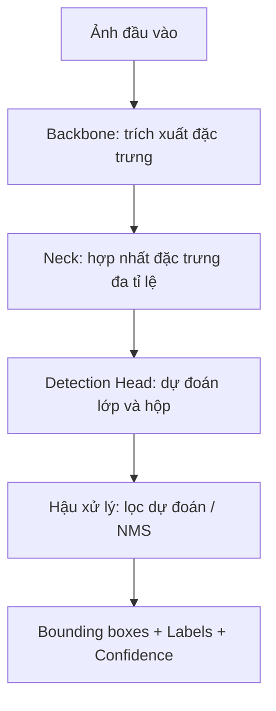
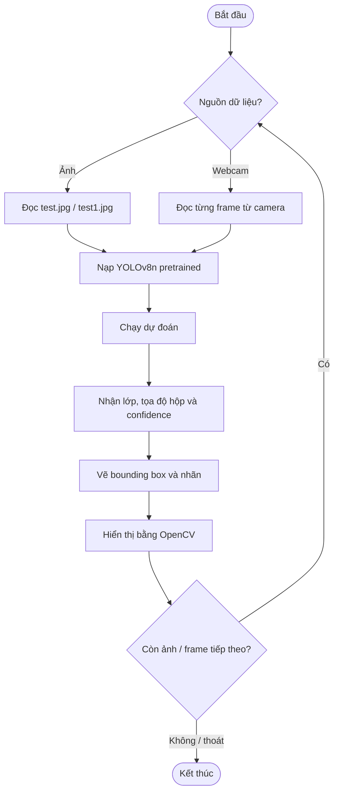
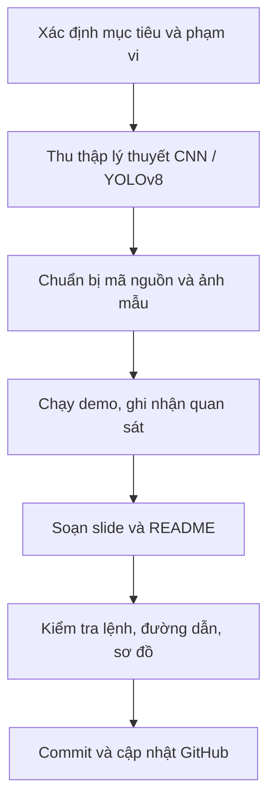
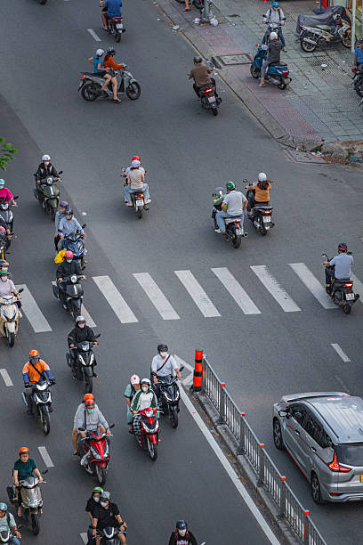
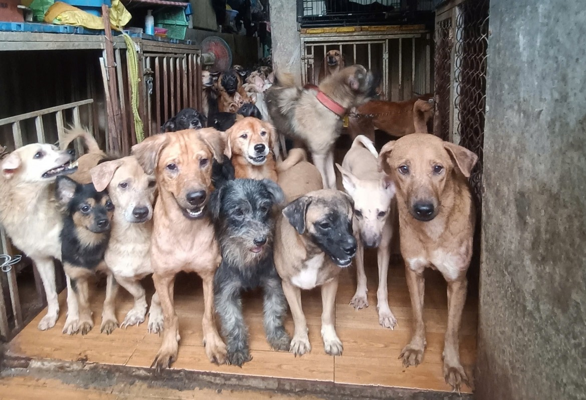

# 🎯 Presentation: Object Detection sử dụng CNN và YOLOv8

   

> **Chủ đề:** Tìm hiểu bài toán phát hiện đối tượng (Object Detection), nền tảng CNN và minh họa suy luận bằng mô hình YOLOv8n đã được huấn luyện sẵn.

**Repository:** [vovietduc/deep-learning-](https://github.com/vovietduc/deep-learning-)  
**Tác giả / tài khoản GitHub:** [vovietduc](https://github.com/vovietduc)  
**Môn học:** Deep Learning  
**Ngày biên soạn:** 31/10/2026  
**Đối tượng đọc:** Giảng viên, sinh viên và người muốn chạy lại demo.

---

## 📑 Mục lục

1. [Tổng quan và mục tiêu](#-tổng-quan-và-mục-tiêu)
2. [Kiến thức nền tảng](#-kiến-thức-nền-tảng)
3. [Kiến trúc YOLOv8](#-kiến-trúc-yolov8)
4. [Sơ đồ quy trình](#-sơ-đồ-quy-trình)
5. [Cấu trúc repository](#-cấu-trúc-repository)
6. [Nội dung bài thuyết trình](#-nội-dung-bài-thuyết-trình)
7. [Cài đặt và chạy demo](#-cài-đặt-và-chạy-demo)
8. [Ảnh thử nghiệm và đánh giá](#-ảnh-thử-nghiệm-và-đánh-giá)
9. [Giới hạn và hướng phát triển](#-giới-hạn-và-hướng-phát-triển)
10. [Tài liệu tham khảo](#-tài-liệu-tham-khảo)

## 📌 Tổng quan và mục tiêu

**Object Detection** là bài toán xác định **đối tượng nào xuất hiện** và **đối tượng nằm ở đâu** trong ảnh/video. Khác với Image Classification (gán nhãn cho toàn ảnh), Object Detection trả về nhiều dự đoán gồm nhãn lớp, tọa độ hộp giới hạn và độ tin cậy.

Mục tiêu bài trình bày:

- Giải thích CNN và vai trò của việc trích xuất đặc trưng ảnh.
- Trình bày nguyên lý phát hiện đối tượng của họ YOLO và các thành phần của YOLOv8.
- Chạy thử mô hình **YOLOv8n pretrained** trên ảnh chứa nhiều chó và ảnh giao thông.
- Minh họa khả năng xử lý video trực tiếp từ webcam.
- Phân tích các giới hạn có thể gặp trong bối cảnh đông đối tượng, che khuất và điều kiện ánh sáng khác nhau.

> **Phạm vi:** Đây là demo **inference với mô hình pretrained**, không phải báo cáo huấn luyện lại (fine-tuning) hay đánh giá định lượng trên bộ dữ liệu kiểm thử có nhãn.

## 🧠 Kiến thức nền tảng

### 1. CNN (Convolutional Neural Network)

CNN là nhóm mạng nơ-ron phù hợp với dữ liệu dạng lưới như hình ảnh. Các phép tích chập giúp học đặc trưng từ đơn giản (cạnh, đường nét) đến phức tạp (bộ phận, hình dạng đối tượng).

| Thành phần | Vai trò cơ bản |
|---|---|
| Convolution | Trích xuất đặc trưng không gian từ ảnh |
| Activation | Tạo tính phi tuyến cho mô hình |
| Downsampling / pooling | Giảm kích thước đặc trưng và chi phí tính toán |
| Feature maps | Biểu diễn đặc trưng để các tầng sau xử lý |

### 2. Classification, Localization và Detection

| Bài toán | Đầu ra |
|---|---|
| Image Classification | Một hoặc nhiều nhãn cho ảnh |
| Object Localization | Vị trí một đối tượng |
| Object Detection | Nhãn và bounding box cho nhiều đối tượng |

### 3. Các khái niệm quan trọng

- **Bounding box:** Hình chữ nhật bao quanh đối tượng được dự đoán.
- **Class label:** Tên lớp, ví dụ `dog`, `person`, `car`, `motorcycle` (nếu mô hình nhận ra).
- **Confidence score:** Điểm tin cậy mô hình gán cho dự đoán, không đồng nghĩa trực tiếp với xác suất dự đoán đúng đã được hiệu chuẩn.
- **IoU (Intersection over Union):** Tỉ lệ diện tích giao trên diện tích hợp giữa hai bounding box.
- **NMS (Non-Maximum Suppression):** Bước loại bớt các hộp dự đoán chồng lấn cho cùng đối tượng.
- **Precision / Recall / mAP:** Các chỉ số đánh giá cần **ground-truth annotations** và quy trình đánh giá phù hợp; không suy ra được chỉ từ hai ảnh minh họa.

## 🏗️ Kiến trúc YOLOv8

**YOLO (You Only Look Once)** thuộc nhóm phương pháp phát hiện đối tượng một giai đoạn (one-stage detector). YOLOv8 kết hợp trích xuất đặc trưng, hợp nhất đặc trưng nhiều tỉ lệ và đầu dự đoán đối tượng. `YOLOv8n` là biến thể nhỏ (nano), phù hợp để demo trên máy cá nhân.



**Backbone** học đặc trưng ảnh; **Neck** kết hợp thông tin ở các tỉ lệ khác nhau để hỗ trợ nhận diện đối tượng lớn và nhỏ; **Detection Head** sinh các dự đoán vị trí và lớp. Sơ đồ trên là mô tả chức năng ở mức khái quát, không phải sơ đồ chi tiết từng lớp của YOLOv8n.

## 🔄 Sơ đồ quy trình

### A. Quy trình suy luận Object Detection



### B. Quy trình chuẩn bị và hoàn thiện bài presentation



## 📁 Cấu trúc repository

```text
deep-learning-/
├── presentation/
│   ├── README.md           # Tài liệu presentation (file này)
│   └── ...                 # Slide PDF/PPTX nếu được bổ sung
├── lab-work/               # Các bài thực hành môn học
├── main.py                 # Chương trình demo
├── yolov8n.pt              # Trọng số YOLOv8n (nếu có trong repo)
├── test.jpg                # Ảnh thử nghiệm giao thông
├── test1.jpg               # Ảnh thử nghiệm nhiều chó
└── .gitignore              # Quy tắc bỏ qua file
```

> Cây thư mục phản ánh cấu trúc được cung cấp; dấu `...` là vị trí dự kiến cho slide, **không khẳng định đã có file slide**. Các đường dẫn ảnh trong README này sử dụng `../` vì README nằm trong `presentation/`.

## 📊 Nội dung bài thuyết trình

Đây là **đề cương slide đề xuất**, không phải danh sách slide đã được xác minh từ file PPTX/PDF:

| Slide | Nội dung | Điểm cần trình bày |
|---|---|---|
| 1 | Trang bìa | Tên đề tài, môn học, nhóm/tác giả |
| 2 | Đặt vấn đề | Vì sao cần phát hiện nhiều đối tượng trong ảnh |
| 3 | Object Detection | Khác biệt với classification và localization |
| 4 | Nền tảng CNN | Convolution, feature maps, trích xuất đặc trưng |
| 5 | Tổng quan YOLO | Khái niệm one-stage detection |
| 6 | Kiến trúc YOLOv8 | Backbone, Neck, Head |
| 7 | Quy trình xử lý | Sơ đồ từ ảnh/webcam đến kết quả |
| 8 | Công cụ triển khai | Python, Ultralytics, OpenCV, YOLOv8n |
| 9 | Demo ảnh | Thử nghiệm ảnh giao thông và ảnh nhiều chó |
| 10 | Demo webcam | Phát hiện đối tượng theo frame |
| 11 | Thảo luận kết quả | Các quan sát thực tế và hạn chế |
| 12 | Kết luận | Kiến thức đạt được, hướng phát triển |

**File slide:** Khi thêm slide, đặt trong `presentation/` và cập nhật liên kết, ví dụ: `[Xem slide PDF](./ten-file-slide.pdf)`.

## ⚙️ Cài đặt và chạy demo

### Yêu cầu

- Python 3 và `pip`.
- Máy tính có thể mở cửa sổ đồ họa OpenCV.
- Webcam hoạt động nếu muốn chạy chế độ webcam.
- File `yolov8n.pt` nằm đúng vị trí mà `main.py` tham chiếu, hoặc cho phép Ultralytics tải trọng số tương ứng khi phù hợp.

### Bước 1. Clone repository

```bash
git clone https://github.com/vovietduc/deep-learning-.git
cd deep-learning-
```

### Bước 2. Tạo môi trường ảo (khuyến nghị)

**Windows PowerShell:**

```powershell
python -m venv .venv
.\.venv\Scripts\Activate.ps1
```

**macOS / Linux:**

```bash
python3 -m venv .venv
source .venv/bin/activate
```

### Bước 3. Cài thư viện

```bash
python -m pip install --upgrade pip
pip install ultralytics opencv-python
```

Ultralytics sử dụng PyTorch; nếu gặp lỗi cài đặt Torch hoặc cần hỗ trợ GPU, xem hướng dẫn cài đặt chính thức ở phần tài liệu tham khảo.

### Bước 4. Chạy

```bash
python main.py
```

Chọn chế độ theo menu thực tế của chương trình:

- **Nhận diện ảnh:** chạy với các ảnh thử nghiệm `test.jpg` và `test1.jpg`.
- **Nhận diện webcam:** đọc frame từ webcam và hiển thị kết quả theo thời gian thực; trong demo này nhấn `Q` để thoát cửa sổ webcam.

Nếu ảnh không mở, kiểm tra tên file và thư mục làm việc hiện tại. Nếu webcam không hoạt động, kiểm tra quyền truy cập camera và ứng dụng khác đang sử dụng camera.

## 🖼️ Ảnh thử nghiệm và đánh giá

### Ảnh 1: Giao thông đường phố



Bối cảnh có nhiều phương tiện, người đi đường và các đối tượng có kích thước khác nhau. Có thể dùng ảnh để thảo luận về **đối tượng nhỏ, mật độ đông, che khuất và góc nhìn từ trên cao**.

### Ảnh 2: Nhiều chó trong cùng khung hình



Bối cảnh có nhiều chó ở gần nhau, kích thước và màu lông khác nhau. Có thể dùng ảnh để thảo luận về **các đối tượng cùng lớp, chồng lấn và che khuất**.

> **Quan trọng:** Hai ảnh trên là **ảnh đầu vào**, chưa phải ảnh kết quả đã vẽ bounding box. Chỉ thêm ảnh kết quả và nhận xét đúng/sai sau khi chạy chương trình và lưu ảnh đầu ra thực tế.

### Bảng ghi nhận kết quả (điền sau khi chạy)

| Trường hợp | Đối tượng kỳ vọng | Quan sát thực tế | Ghi chú |
|---|---|---|---|
| `test.jpg` | Người, xe máy, ô tô (tùy ảnh) | Chưa ghi nhận | Đánh giá trường hợp đông đối tượng |
| `test1.jpg` | Chó | Chưa ghi nhận | Đánh giá trường hợp che khuất |
| Webcam | Phụ thuộc khung hình | Chưa ghi nhận | Độ trễ phụ thuộc phần cứng |

Không báo cáo **accuracy, FPS, mAP hoặc số đối tượng phát hiện** khi chưa đo hoặc kiểm chứng thực tế.

## ⚠️ Giới hạn và hướng phát triển

**Giới hạn:** Mô hình pretrained chỉ dự đoán các lớp đã được học; hiệu quả có thể giảm khi ảnh mờ, ánh sáng kém, đối tượng quá nhỏ hoặc bị che khuất. Kết quả trên vài ảnh không đủ để kết luận độ chính xác tổng quát.

**Hướng phát triển:**

- Lưu ảnh/video đầu ra đã được vẽ bounding box.
- Đo thời gian suy luận và FPS trên phần cứng xác định.
- Thử nhiều ngưỡng confidence để quan sát thay đổi kết quả.
- Đánh giá trên bộ dữ liệu có gán nhãn bằng Precision, Recall và mAP.
- Fine-tune trên dữ liệu chuyên biệt nếu bài toán yêu cầu lớp đối tượng mới.

## 📚 Tài liệu tham khảo

1. [Ultralytics YOLO Documentation](https://docs.ultralytics.com/)
2. [Ultralytics YOLOv8 Models](https://docs.ultralytics.com/models/yolov8/)
3. [OpenCV Documentation](https://docs.opencv.org/)
4. [PyTorch Documentation](https://pytorch.org/docs/stable/index.html)
5. Tài liệu học phần Deep Learning do giảng viên cung cấp (bổ sung tên tài liệu khi trích dẫn cụ thể).

## 📬 Liên hệ

**GitHub:** [@vovietduc](https://github.com/vovietduc)  
**Repository:** [deep-learning-](https://github.com/vovietduc/deep-learning-)

---

*README phục vụ mục đích học tập và trình bày. Hãy cập nhật đường dẫn slide, kết quả demo và thông tin nhóm trước khi nộp bài.*
